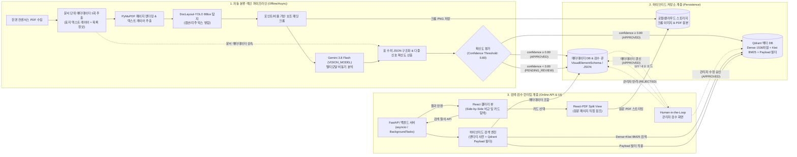
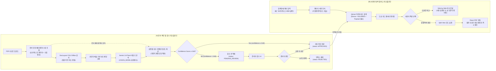

# [통합 기획·설계서] FigIndex: 금융·산업 리포트 도표·차트 자동 분류·색인 시스템

> **문서 상태**: v0.3.1 (통합본)  
> **프로젝트 기간**: 3~4주 (팀원 5명)  
> **프로젝트 주제**: 금융·산업 도메인 특화 비정형 시각 콘텐츠 자동 분류 및 멀티모달 색인 시스템  
> **기준 문서**: FigIndex PRD v0.3.1 기반 단일 통합

---

## 1. 프로젝트 개요 및 기획 배경

### 1.1 한 줄 기획
> **한경 컨센서스 등 증권사 리서치 PDF에서 줄글은 과감히 건너뛰고, 핵심 ‘표(TABLE), 차트(CHART), 밸류체인 다이어그램(DIAGRAM)’만 AI 비전으로 정밀 추출·구조화하여 직관적으로 비교·검색하는 시각 자료 전용 지식 도서관**

### 1.2 해결하려는 핵심 문제 3가지

| 문제 유형 | 상세 내용 | 업무에 미치는 영향 |
| :--- | :--- | :--- |
| **도표 내 텍스트 검색 불가 (Ctrl+F 한계)** | 상당수 리서치 리포트의 표와 차트가 단일 비트맵 이미지이거나, 텍스트 레이어가 존재하더라도 복잡한 다단 및 표 레이아웃으로 인해 텍스트 구조가 깨져 있어 키워드 검색(Ctrl+F)이 사실상 불가능함. | 애널리스트/투자자가 "HBM3E 출하량 추이"를 찾기 위해 수십 페이지 분량의 리포트 수십 편을 일일이 육안 스크롤해야 함. |
| **통짜 PDF 처리의 비효율 (토큰 과다 & 왜곡)** | 기존 RAG 파이프라인에 PDF 전체 페이지를 그대로 전달하면 방대한 줄글로 인해 LLM 토큰 비용이 급증함. | 텍스트 추출 시 복잡한 2단 컬럼과 도표 내 다중 행/열 수치가 뒤섞여 파싱 왜곡(Hallucination) 발생. |
| **다자간 출처 비교 분석의 불편함** | 여러 증권사(삼성, 미래에셋, KB 등)가 제시한 동일 지표의 추정치를 한눈에 모아 비교하기 어려움. | 각 리포트 탭을 여러 개 열어두고 수치를 수작업 엑셀로 재입력하는 병목 현상 초래. |

### 1.3 사용자 정의 및 차별화 가치

| 대상 사용자 | 역할 정의 및 Pain Point | FigIndex 제공 가치 (차별점) |
| :--- | :--- | :--- |
| **일반 사용자**<br>(개인 투자자, 취업 준비생, 리서처) | 줄글 위주의 긴 리포트 완독 부담, 원하는 핵심 요약 도표만 빠르게 확인하고 싶음 | 키워드 한 번으로 증권사별 핵심 전망 차트 및 수치 요약 카드를 핀터레스트형 갤러리로 탐색 |
| **금융 실무자 / 애널리스트**<br>(투자 심사역, 전략기획자, RA) | 표 안의 수치 데이터(Markdown/JSON) 재가공 소요 시간 과다, 출처 검증 번거로움 | 도표 원본 크롭 이미지 + 구조화 수치(JSON) 다운로드 + **클릭 한 번으로 원본 PDF 해당 페이지 즉시 점프** |
| **데이터 관리자 (Admin)** | 비정형 AI 추출 데이터의 정합성 유지 및 품질 관리 부담 | 확신도 0.80 미만 항목이 자동 격리되는 검수 탭에서 클릭 한 번으로 수정·승인(`APPROVED`) 또는 반려(`REJECTED`) |

### 1.4 핵심 사용자 스토리
1. **투자자 A**: *"나는 2025년 반도체 수출 추정치 차트만 모아서 보고 싶어서, 검색창에 '반도체 수출 전망'을 입력하고 차트(`CHART`) 필터를 적용해 여러 증권사의 시각 자료를 한 화면에서 한눈에 비교한다."*
2. **실무자 B**: *"나는 도표에 적힌 수치가 정확한지 검증하기 위해, 카드 상세 모달에서 [원문 확인]을 눌러 해당 PDF 14페이지의 원본 문맥을 즉시 확인한다."*
3. **관리자 C**: *"나는 새로 업로드된 리포트 중 추출이 불완전하거나 확신도가 0.80 미만인 표 항목을 검수 탭(`PENDING_REVIEW`)에서 확인하고, 잘못 지정된 태그를 올바르게 수정한 뒤 즉시 승인(`APPROVED`)하여 대고객 서비스에 노출시킨다."*

### 1.5 비목표 (Non-Goals - MVP 범위 제외)
- 실시간 주식 시세 데이터 연동 및 매매 주문 기능
- 전 세계 모든 언어/비표준 포맷 PDF 지원 (국내 한경 컨센서스 표준 리포트 중심)
- 대화형 챗봇의 자율 보고서 생성 (도표 검색·비교 및 원문 점프 뷰어 기능에 집중)
- 도표 간 행/열 동적 정렬 및 단위 자동 환산 정규화 (차기 확장 P1-03으로 이관)

---

## 2. 시스템 아키텍처 및 저장 계층

### 2.1 전체 시스템 구조도



### 2.2 저장소 계층 데이터 역할 정의

| 저장소 컴포넌트 | 저장 데이터 | 주요 목적 및 기술 스펙 |
| :--- | :--- | :--- |
| **Qdrant (Vector DB)** | • 도표 제목/캡션 및 요약문 Dense 임베딩 벡터 (`text-embedding-3-small`, 1536차원)<br/>• 형태소 분석기 **Kiwi(키위)** 기반 한국어 BM25 Sparse 토큰<br/>• **Payload 필터 필드**: `company`, `ticker`, `broker`, `publish_date`, `analyst`, `industry` | 시맨틱 의미 검색과 기업명/종목코드 정확 일치를 결합한 초고속 하이브리드 검색 (Payload 필터 결합) |
| **이미지/문서 스토리지** | • 크롭된 도표 이미지 파일 (`.png`)<br/>• 원본 리서치 리포트 문서 파일 (`.pdf`) | 정적 파일 서빙 및 웹 프론트엔드 이미지/React-PDF 뷰어 직접 스트리밍 |
| **메타데이터 & 검수 큐 (RDB/JSON)** | • `VisualElementSchema` 전체 메타데이터 레코드<br/>• 표 구조화 정형 데이터 (`structured_data` JSON)<br/>• 검수 상태값: `APPROVED` (자동/수동 승인), `PENDING_REVIEW` (검수 대기), `REJECTED` (반려) | CRUD 트랜잭션, 정형 수치 렌더링 지원, 미승인 도표의 관리자 검수 상태 추적 |

---

## 3. 데이터 처리 및 사용자 흐름도



---

## 4. AI 비전 파이프라인 및 확신도(Confidence) 산출 체계

### 4.1 DocLayout-YOLO 기반 줄글 배제 (LLM 토큰 80% 이상 절감)
- 문서 레이아웃 분석 특화 경량 비전 모델로 본문 텍스트를 배제하고, `TABLE`, `CHART`, `DIAGRAM` BBox만 정밀 크롭합니다.
- **비교 기준**: **PDF 전체 페이지 이미지 입력 대비 크롭 도표 기반 입력 토큰 소비량을 80% 이상 절감**합니다.
- DocLayout-YOLO는 차트와 다이어그램을 구분하지 않고 단일 `figure` 클래스로 탐지하므로, **`CHART`와 `DIAGRAM`의 의미론적 세부 분류는 Vision LLM이 전담**합니다.

### 4.2 캡션/각주 경계 상자 병합(Union BBox) 및 보조 패딩 규칙
- DocLayout-YOLO가 탐지하는 `table_caption`, `figure_caption`, `table_footnote` 박스를 인접 본 박스와 **경계 상자 병합(Union BBox)**하여 상단 제목 및 하단 단위/출처 텍스트 잘림을 원천 방지합니다.
- 고정 픽셀(px) 대신 **PDF 포인트(상하 10pt, 좌우 5pt)** 또는 **페이지 높이 대비 비율(1.5%)**의 보조 패딩을 적용하여 다양한 해상도(DPI)에서도 왜곡 없이 크롭합니다.

### 4.3 Gemini 3.8 Flash 기반 표 수치 JSON 구조화 및 문서 메타데이터 상속
- 이미지화된 복잡한 다중 행/열 금융 재무제표 및 전망치 표를 인식하여 정형 JSON 포맷(`columns`, `rows`, `unit`, `period_labels`)과 Markdown 표로 복원합니다.
- **문서 메타데이터 분리 추출 및 상속**: 리포트 수준의 메타데이터(`company`, `ticker`, `broker`, `publish_date`, `analyst`, `industry`)는 개별 도표마다 LLM에 재질의하지 않고, **문서 단위로 1회 추출(표지 페이지 텍스트 레이어 + 수집 시 목록 정보)**한 후 해당 문서 내 모든 도표(`VisualElementSchema`)에 상속하여 중복 토큰을 방지하고 일관성을 보장합니다.
- **모델명은 환경변수(`VISION_MODEL="gemini-3.8-flash"`)로 분리**하여 코드 변경 없이 최신 모델로 교체할 수 있도록 설계합니다.

### 4.4 유형별 가중치 재정규화 기반 확신도(Confidence Score) 산출 공식
금융 데이터의 특성상 1%의 수치 오류도 치명적이므로, 단일 LLM의 자체 보고 점수에 의존하지 않고 다음 **5개 신호**를 측정하여 종합 확신도를 계산합니다:

1. **신호 1 (탐지 점수, $s_1$)**: DocLayout-YOLO 레이아웃 탐지 신뢰도 ($s_1 \in [0.0, 1.0]$, 기본 가중치 $w_1 = 0.20$)
2. **신호 2 (스키마 유효성, $s_2$)**: Pydantic 기반 JSON 스키마 검증 통과 여부 (**$s_2 \in \{0, 1\}$ 이진값**, 통과 시 1, 실패 시 0, 기본 가중치 $w_2 = 0.25$)
3. **신호 3 (수치 정합성, $s_3$)**: 가로/세로 합계·소계 일치율 및 행별 열 개수 일관성 ($s_3 \in [0.0, 1.0]$, 기본 가중치 $w_3 = 0.25$)
4. **신호 4 (Self-consistency, $s_4$)**: 동일 이미지 2회 추론 결과 일치도 ($s_4 \in [0.0, 1.0]$, 기본 가중치 $w_4 = 0.15$)
   - **조건부 실행 규칙**: 비용 및 응답 속도 최적화를 위해 **`TABLE` 유형이거나, 1차 확신도가 0.70~0.85 경계 구간일 때만 조건부 실행**합니다. (미실행 시 $s_4 = 1.0$ 적용)
5. **신호 5 (텍스트 일치율, $s_5$)**: PDF 텍스트 레이어 존재 시 BBox 내 추출 텍스트와 LLM 수치 일치율 ($s_5 \in [0.0, 1.0]$, 기본 가중치 $w_5 = 0.15$)

#### 가중치 재정규화(Re-normalization) 원칙
도표 유형(표 vs 차트/다이어그램) 및 텍스트 레이어 유무에 따라 측정 불가능한 신호를 제외하고, **적용 가능한 신호들의 가중치 합이 정확히 1.0이 되도록 재정규화**합니다:

$$\text{Confidence Score} = \sum_{i \in \text{적용 신호}} w'_i \cdot s_i, \quad \text{where } w'_i = \frac{w_i}{\sum_{j \in \text{적용 신호}} w_j}$$

#### 유형별 재정규화된 초기 가중치 표

| 도표 유형 및 조건 | 적용 가능 신호 | 신호별 기본 가중치 ($w_i$) | 가중치 합 | 재정규화 가중치 ($w'_i$, 가중치 합 1.00) |
| :--- | :--- | :--- | :---: | :--- |
| **TABLE<br>(텍스트 레이어 있음)** | 신호 1, 2, 3, 4, 5 전부 | • 신호 1: 0.20<br>• 신호 2: 0.25<br>• 신호 3: 0.25<br>• 신호 4: 0.15<br>• 신호 5: 0.15 | 1.00 | • **신호 1 (탐지 점수)**: 0.200 (20.0%)<br>• **신호 2 (스키마 통과)**: 0.250 (25.0%)<br>• **신호 3 (수치 정합성)**: 0.250 (25.0%)<br>• **신호 4 (Self-consistency)**: 0.150 (15.0%)<br>• **신호 5 (텍스트 일치율)**: 0.150 (15.0%) |
| **TABLE<br>(텍스트 레이어 없음)** | 신호 1, 2, 3, 4<br>(신호 5 제외) | • 신호 1: 0.20<br>• 신호 2: 0.25<br>• 신호 3: 0.25<br>• 신호 4: 0.15 | 0.85 | • **신호 1 (탐지 점수)**: 0.235 (23.5%)<br>• **신호 2 (스키마 통과)**: 0.294 (29.4%)<br>• **신호 3 (수치 정합성)**: 0.294 (29.4%)<br>• **신호 4 (Self-consistency)**: 0.177 (17.7%) |
| **CHART / DIAGRAM** | 신호 1, 2, 4<br>(신호 3, 5 제외) | • 신호 1: 0.20<br>• 신호 2: 0.25<br>• 신호 4: 0.15 | 0.60 | • **신호 1 (탐지 점수)**: 0.333 (33.3%)<br>• **신호 2 (스키마 통과)**: 0.417 (41.7%)<br>• **신호 4 (Self-consistency)**: 0.250 (25.0%) |

- **단일 임계값 라우팅**:
  - `confidence ≥ 0.80`: `APPROVED` (자동 대고객 노출)
  - `confidence < 0.80`: `PENDING_REVIEW` (관리자 검수 큐 격리)
  - 관리자 승인 시 `APPROVED`, 반려 시 `REJECTED`

---

## 5. 기능 요구사항 (Functional Requirements)

### 5.1 필수 구현 기능 (Priority 0: P0)

| ID | 기능명 | 기능 상세 설명 | 수용 기준 (Acceptance Criteria) |
| :--- | :--- | :--- | :--- |
| **P0-01** | **PDF 레이아웃 분석 및 크롭** | • DocLayout-YOLO로 도표 BBox 감지<br/>• 탐지된 캡션/각주 박스를 인접 본 박스와 **경계 상자 병합(Union BBox)** 처리<br/>• PDF 포인트(상하 10pt, 좌우 5pt) 또는 페이지 높이 대비 비율(1.5%) 보조 패딩을 적용하여 PNG 자동 크롭 | • 10페이지 리포트 기준 15초 이내 처리 완료<br/>• 핵심 도표 누락률 15% 미만 (재현율 85% 이상)<br/>• 도표 상단 캡션 및 하단 단위/출처 텍스트가 잘리지 않을 것 |
| **P0-02** | **멀티모달 AI 분석 및 메타데이터 상속** | • Gemini 3.8 Flash(`VISION_MODEL`)로 시각 요소 분류, 한글 캡션 요약, 해시태그 추출<br/>• **리포트 메타데이터(`company`, `ticker`, `broker`, `publish_date`, `analyst`, `industry`)는 표지 텍스트 레이어 및 수집 정보에서 문서 단위 1회 추출하여 도표에 상속**<br/>• DocLayout-YOLO의 단일 `figure` 검출에 대응하여 **`CHART` vs `DIAGRAM`의 세부 의미론적 분류는 Vision LLM이 담당** | • `TABLE`, `CHART`, `DIAGRAM` 3종으로 정확 분류<br/>• 도표 핵심 시사점 2~3줄 요약문 생성<br/>• 연관 종목 및 산업 키워드 해시태그 3개 이상 추출 |
| **P0-03** | **표 수치 JSON 구조화** | `TABLE`로 분류된 이미지의 다중 행/열 수치 데이터를 정형 JSON(`columns`, `rows`, `unit`, `period_labels`)으로 변환 | • 표 헤더(컬럼명), 행 라벨, 단위(`%`, `십억원` 등), 기간 라벨이 분리된 JSON 생성<br/>• 원본 표와 대조 시 주요 수치 일치율 95% 이상 |
| **P0-04** | **유형별 재정규화 확신도 라우팅** | • 유형별(표 텍스트유무, 차트) 적용 가능 신호만 반영한 **가중치 재정규화 확신도 산출**<br/>• 신호 2(스키마 유효성)는 0/1 이진값 적용<br/>• Self-consistency 2회 추론은 `TABLE` 또는 확신도 0.70~0.85 경계 구간에만 조건부 실행<br/>• 단일 임계값(0.80) 기반 라우팅 | • Confidence ≥ 0.80: `APPROVED`<br/>• Confidence < 0.80: `PENDING_REVIEW`<br/>• 관리자 승인 시 `APPROVED`, 반려 시 `REJECTED` |
| **P0-05** | **하이브리드 검색 엔진** | • Dense Vector: `text-embedding-3-small` (1536차원, 시맨틱 검색)<br/>• Sparse/BM25: 형태소 분석기 **Kiwi(키위)** 기반 한국어 토크나이징<br/>• **기업명/종목코드 정확 일치**: 금융 기업명 사전으로 사용자 쿼리에서 개체명을 인식한 뒤 Qdrant payload keyword filter(`company`, `ticker`)로 결합 | • 기업명/종목코드 검색 시 정확 일치 보장<br/>• 의미적 질의 시 연관 도표 상위 노출 (Precision@5 ≥ 0.75)<br/>• 검색 응답 시간 1.0초 이내 |
| **P0-06** | **도표 비교 갤러리 UI** | • 추출된 시각 자료를 카드 형태로 렌더링<br/>• **MVP 비교 범위**: 사전 검증된 비교 가능한 두 도표 카드를 선택하여 팝업창에서 나란히(Side-by-Side) 렌더링하고 수치를 비교 대조 | • 핀터레스트형 카드 갤러리 렌더링<br/>• 필터링 제공 (유형: `TABLE`/`CHART`, 증권사, 발행일자)<br/>• '비교함' 선택 시 Side-by-Side 비교 모달 제공 |
| **P0-07** | **원문 PDF 페이지 즉시 점프** | 도표 상세 뷰에서 버튼 클릭 시 원본 PDF를 불러와 해당 페이지로 즉시 이동 | • React-PDF 기반 Split View 구현<br/>• 메타데이터의 `page_number`로 지연 없이 자동 스크롤 점프 |

### 5.2 차기 확장 기능 (Priority 1: P1)
- **P1-01**: 구조화된 표 수치의 엑셀(`.xlsx`) 및 CSV 파일 다운로드 기능
- **P1-02**: 관리자 검수 결과(Human Feedback)를 활용한 프롬프트 자동 튜닝 및 Few-shot 예시 축적
- **P1-03**: 도표 간 행/열 동적 정렬 및 단위 정규화 (억원 ↔ 십억원, 2025E ↔ 25F 자동 환산 및 통일 매핑)

---

## 6. 화면 요구사항

| 화면명 | 주요 UI 구성 요소 | 사용자 인터랙션 |
| :--- | :--- | :--- |
| **메인 검색 및 갤러리** | • 상단 통합 검색창 (키워드/자연어 질의)<br/>• 카테고리 칩 필터 (`전체`, `TABLE`, `CHART`, `DIAGRAM`)<br/>• 증권사, 발행일, 기업명 드롭다운 필터<br/>• 반응형 카드 그리드 (도표 썸네일, 캡션, 요약문, 출처 태그) | • 카드 호버 시 줌 프리뷰 제공<br/>• [비교함 담기] 체크박스 클릭 (최대 2개)<br/>• 카드 클릭 시 상세 Split View 모달 진입 |
| **상세 및 원문 점프 분할 뷰 (Split View)** | • 좌측: 고해상도 도표 이미지 및 구조화 수치 JSON/Markdown 렌더러<br/>• 우측: React-PDF 리포트 뷰어 (해당 페이지 자동 포커싱)<br/>• 출처 정보: 기업명, 종목코드, 증권사명, 리포트 제목, 발행일, 담당 애널리스트 | • 좌측 표의 셀 값 마우스 드래그 및 복사<br/>• 우측 PDF 뷰어 내 이전/다음 페이지 탐색<br/>• [원문 다운로드] 버튼 제공 |
| **업로드 및 처리 상태 뷰** | • PDF 파일 드래그 앤 드롭 업로더<br/>• 파이프라인 진행률 프로그레스 바 (파싱 -> 크롭 -> AI 분석 -> 완료) | • 다중 파일 일괄 업로드<br/>• 파이프라인 단계별 처리 시간 및 성공/실패 토스트 알림 |
| **관리자 검수 탭 (HITL)** | • `PENDING_REVIEW` 상태(확신도 0.80 미만)의 도표 목록 테이블<br/>• 원본 크롭 이미지와 AI 추출 텍스트 대조 뷰<br/>• 유형 교정 드롭다운 및 [승인(`APPROVED`)], [반려(`REJECTED`)] 버튼 | • 수정 필드 인라인 편집<br/>• 단축키(`A`: 승인, `R`: 반려)를 통한 고속 검수 처리 지원 |

---

## 7. 데이터 요구사항 (`schemas.py` 모델 명세)

**기업명, 증권사, 발행일, 산업 등의 필터링은 파일명(`doc_name`) 파싱이 아니라, 문서 수준에서 1회 추출되어 상속 저장된 Qdrant payload 필터를 통해 동작합니다.**

```python
# app/schemas.py (통합 참조 명세 v0.3.1)
from datetime import date
from enum import Enum
from typing import List, Optional, Dict, Any
from pydantic import BaseModel, Field

class ElementType(str, Enum):
    TABLE = "TABLE"
    CHART = "CHART"
    DIAGRAM = "DIAGRAM"

class ReviewStatus(str, Enum):
    APPROVED = "APPROVED"
    PENDING_REVIEW = "PENDING_REVIEW"
    REJECTED = "REJECTED"

class TableStructure(BaseModel):
    """structured_data 내부 스키마"""
    columns: List[str] = Field(..., description="열 헤더 목록")
    rows: List[Dict[str, Any]] = Field(..., description="행 데이터 목록")
    unit: Optional[str] = Field(None, description="수치 단위 (예: 십억원, %, 달러)")
    period_labels: List[str] = Field(default_factory=list, description="기간 레이블 (예: ['2023', '2024E', '2025E'])")

class VisualElementSchema(BaseModel):
    element_id: str = Field(..., description="시각 요소 고유 식별자 (UUIDv4)")
    doc_name: str = Field(..., description="원본 PDF 파일명 (예: 20250106_SK하이닉스_삼성증권.pdf)")
    page_number: int = Field(..., description="해당 요소가 위치한 PDF 페이지 번호 (1-based)")
    bbox: List[float] = Field(..., description="크롭 바운딩 박스 정규 좌표 [ymin, xmin, ymax, xmax]")
    element_type: ElementType = Field(..., description="시각 요소 분류 (TABLE, CHART, DIAGRAM)")
    image_path: str = Field(..., description="크롭된 이미지 저장 경로 (/static/crops/...)")
    title_or_caption: str = Field(..., description="도표의 상단 제목 또는 식별 캡션")
    summary: str = Field(..., description="멀티모달 모델이 생성한 핵심 내용 2~3줄 요약")
    structured_data: Optional[TableStructure] = Field(None, description="표 수치 구조화 정형 데이터")
    hashtags: List[str] = Field(default_factory=list, description="연관 검색 태그 및 키워드 목록")
    confidence_score: float = Field(..., ge=0.0, le=1.0, description="재정규화 다중 신호 가중합 확신도 (0.0 ~ 1.0)")
    review_status: ReviewStatus = Field(default=ReviewStatus.PENDING_REVIEW, description="검수 상태 (기본값 PENDING_REVIEW, 0.80 이상 시 APPROVED 승격)")
    
    # Qdrant Payload 필터 지원 필드 (문서 단위 1회 추출 후 도표에 상속)
    company: str = Field(..., description="대상 기업명 (예: SK하이닉스)")
    ticker: Optional[str] = Field(None, description="종목코드 (예: 000660)")
    broker: str = Field(..., description="발행 증권사 (예: 삼성증권)")
    publish_date: date = Field(..., description="리포트 발행일자 (YYYY-MM-DD)")
    analyst: Optional[str] = Field(None, description="작성 애널리스트명")
    industry: str = Field(..., description="산업 분류 (예: 반도체)")
```

### 7.1 필드 상세 설명 표

| 필드명 | 데이터 타입 | 필수 여부 | 설명 및 예시 |
| :--- | :--- | :---: | :--- |
| `element_id` | `str` | Y | 도표 전역 고유 식별자 (예: `fig-9b1deb4d-3b7d-4bad-9bdd-2b0d7b3dcb6d`) |
| `doc_name` | `str` | Y | 출처 리포트 원본 파일명 (예: `20250115_반도체_미래에셋.pdf`) |
| `page_number` | `int` | Y | 리포트 내 1부터 시작하는 실제 페이지 번호 (예: `14`) |
| `bbox` | `List[float]` | Y | 페이지 내 정규 좌표 `[ymin, xmin, ymax, xmax]` (보조 패딩 포함) |
| `element_type` | `ElementType` | Y | `TABLE`, `CHART`, `DIAGRAM` 3종 |
| `image_path` | `str` | Y | 서버 내 정적 파일 저장 URL (예: `/static/crops/fig_14_01.png`) |
| `title_or_caption` | `str` | Y | 도표 제목 (예: `[표 3] 글로벌 HBM 세대별 수요 전망`) |
| `summary` | `str` | Y | 핵심 요약문 (예: `2025년 HBM3E 비중이 70%를 상회할 것으로 전망...`) |
| `structured_data` | `Optional[TableStructure]` | N | 정형 수치 객체 (`columns`, `rows`, `unit`, `period_labels`) |
| `hashtags` | `List[str]` | Y | 인덱싱 키워드 (예: `["#SK하이닉스", "#HBM3E", "#반도체"]`) |
| `confidence_score` | `float` | Y | 재정규화 가중합 확신도 (예: `0.92`) |
| `review_status` | `ReviewStatus` | Y | 검수 상태 (**기본값 `PENDING_REVIEW`**, 확신도 0.80 이상 시 `APPROVED`로 자동 승격) |
| `company` | `str` | Y | 대상 기업명 (예: `SK하이닉스`, 문서 표지 추출 후 상속) |
| `ticker` | `Optional[str]` | N | 6자리 종목코드 (예: `000660`, 문서 표지 추출 후 상속) |
| `broker` | `str` | Y | 발행 증권사 (예: `미래에셋증권`, 문서 표지 추출 후 상속) |
| `publish_date` | `date` | Y | 리포트 발행일 (예: `2025-01-15`, 문서 표지 추출 후 상속) |
| `analyst` | `Optional[str]` | N | 담당 애널리스트명 (예: `김연구`, 문서 표지 추출 후 상속) |
| `industry` | `str` | Y | 산업 분류 (예: `반도체`, 문서 표지 추출 후 상속) |

### 7.2 `structured_data` 예시 JSON

```json
{
  "columns": ["구분", "2023", "2024E", "2025E", "2026E"],
  "rows": [
    {
      "구분": "HBM3 (16GB)",
      "2023": 210,
      "2024E": 450,
      "2025E": 520,
      "2026E": 310
    },
    {
      "구분": "HBM3E (24/36GB)",
      "2023": 0,
      "2024E": 320,
      "2025E": 1250,
      "2026E": 1980
    },
    {
      "구분": "합계",
      "2023": 210,
      "2024E": 770,
      "2025E": 1770,
      "2026E": 2290
    }
  ],
  "unit": "백만 달러",
  "period_labels": ["2023", "2024E", "2025E", "2026E"]
}
```

---

## 8. MVP 프로젝트 운영 및 성공 기준

### 8.1 3~4주 MVP 목표 범위

| 구분 | MVP 목표 스펙 | 세부 기준 |
| :--- | :--- | :--- |
| **대상 데이터** | 한경 컨센서스 증권사 리포트 50 ~ 100건 | 반도체, 이차전지, 자동차 등 핵심 산업 리포트 중심 |
| **추출 도표 규모** | 핵심 시각 요소 300 ~ 500건 추출 | 노이즈(로고, 헤더/푸터 장식선 등) 제외 완료 기준 |
| **시각 요소 분류** | 3종 분류 (`TABLE`, `CHART`, `DIAGRAM`) | 재무·실적표, 추이 차트, 밸류체인/구조 다이어그램 |
| **색인 및 검수** | 단일 임계값(0.80) 기준 2-Way 라우팅 & 3단계 상태 관리 | `APPROVED`(자동 노출), `PENDING_REVIEW`(검수 대기), `REJECTED`(반려) |
| **사용자 인터페이스** | 검색/비교 갤러리 + Split View 뷰어 | 하이브리드 검색, 카드 나란히 비교(Side-by-Side), PDF 페이지 직접 점프 |

### 8.2 정량적 성공 기준 (Success Metrics)

| 측정 항목 | 목표 수치 | 측정 방법 |
| :--- | :--- | :--- |
| **단일 PDF 처리 속도** | 10페이지 리포트 기준 **15초 이내** | 비동기 크롭 및 병렬 LLM API 호출 소요 시간 |
| **도표 크롭 재현율 (Recall)** | **85% 이상** | 테스트셋 50페이지 내 실제 핵심 도표 대비 추출 성공률 |
| **검색 정확도 (Precision@5)** | **0.75 이상** | 도표 검색어 상위 5개 결과 중 관련 도표 포함 비율 |
| **LLM 토큰 절감률** | **80% 이상 절감** | **PDF 전체 페이지 이미지 입력 대비 크롭 도표 기반 입력 토큰 사용량 비교** |
| **사용자 검색 응답 속도** | 쿼리 입력 후 **1.0초 이내** | Qdrant 하이브리드 인덱스 조회 및 메타데이터 페이징 응답 속도 |

### 8.3 출시 수용 기준 (Definition of Done)

1. [ ] **데이터 수집 및 크롭 완결성**: 증권사 리포트 50건 이상에서 300개 이상의 유효 도표/차트가 누락 없이 캡션 병합 및 보조 패딩을 유지한 채 정상 크롭되어야 함.
2. [ ] **구조화 데이터 생성율**: `TABLE`로 분류된 전체 항목 중 90% 이상에 대해 유효한 `structured_data` JSON이 정상 파싱되어야 함.
3. [ ] **하이브리드 검색 속도 및 품질**: 임의의 기업명+지표 질의 시 1초 이내에 연관 도표 상위 5개가 반환되고, Precision@5가 0.75 이상이어야 함.
4. [ ] **원문 페이지 점프 정합성**: 갤러리 내 모든 도표 카드에서 [원문 보기] 클릭 시, 100% 오차 없이 해당 리포트의 실제 `page_number`로 즉시 스크롤 점프되어야 함.
5. [ ] **HITL 검수 루프 검증**: 확신도 0.80 미만 항목이 검수 UI(`PENDING_REVIEW`)에 정상 격리되고, 관리자 승인 시 즉시 검색 인덱스(`APPROVED`)에 실시간 반영되는 전체 루프가 정상 동작해야 함.

---

## 9. 팀원 5인 역할 분담 (R&R) 및 4주 마일스톤

### 9.1 팀원 5인 역할 분담 (R&R)

| 담당자 | 주요 역할 | 세부 담당 태스크 |
| :--- | :--- | :--- |
| **팀원 A (전처리/비전)** | PDF 전처리 및 레이아웃 탐지 | • PyMuPDF 파이프라인 구축 및 고해상도(200~300 DPI) 이미지 렌더링<br/>• 샘플 10건 대상 비트맵 vs 벡터 텍스트 레이어 비율 전수 조사<br/>• DocLayout-YOLO 사전학습 추론, 캡션 병합 및 포인트/비율 기반 패딩 크롭 최적화<br/>• **도표 탐지 정답셋(50페이지 BBox Ground Truth) 구축 주도** |
| **팀원 B (AI 색인/품질)** | 멀티모달 LLM 연동 및 품질 검증 | • Gemini 3.8 Flash (`VISION_MODEL`) 비동기 배치 파이프라인 구축<br/>• 표 구조화(JSON), 캡션 요약, 해시태그 및 재정규화 확신도 산출 로직 설계<br/>• **표 수치 정답셋(표 30개 Ground Truth) 및 검색 쿼리 20개 Qrel 라벨링 주도**<br/>• 2주차 검증셋 기반 확신도 가중치 튜닝 |
| **팀원 C (DB/검색 엔지니어)** | 벡터 DB 및 하이브리드 검색 구현 | • Qdrant 컬렉션 설계 (Dense 1536차원 + Kiwi 형태소 BM25)<br/>• 금융 기업명 사전 구축 및 payload 필터(`company`, `ticker`, `broker`, `publish_date` 등) 연동<br/>• 하이브리드 검색 가중치 튜닝 및 검색 성능 평가 |
| **팀원 D (백엔드 아키텍처)** | FastAPI 비동기 서버 개발 | • PDF 업로드 및 FastAPI `BackgroundTasks`/`asyncio` 파이프라인 연동<br/>• 검색 API, 상세 조회 API, 관리자 검수 상태(`APPROVED`, `PENDING_REVIEW`, `REJECTED`) API 구현 및 Swagger 문서화 |
| **팀원 E (프론트엔드/UX)** | 웹 UI 및 시각화 뷰어 구현 | • 핀터레스트 스타일 도표 검색/필터 갤러리 구현<br/>• 도표 Side-by-Side 비교 모달 창 구현 (두 표 나란히 렌더링)<br/>• React-PDF 연동: 도표 클릭 시 원문 PDF 해당 페이지 즉시 Split View 점프 및 검수 UI 제작 |

### 9.2 4주 개발 마일스톤

| 주차 | 주간 목표 | 주요 산출물 |
| :--- | :--- | :--- |
| **1주차 (설계 & 프로토타입)** | • 데이터 수집 (리포트 50건 확보)<br/>• 샘플 10건 대상 비트맵 vs 벡터 텍스트 비율 조사<br/>• DocLayout-YOLO 사전학습 모델 추론 성능 확인 (성능 부족 시 2주차 파인튜닝 검토)<br/>• **도표 탐지/크롭 정답셋(50페이지) 라벨링 착수** | • PDF 수집본 및 텍스트 레이어 조사 보고서<br/>• DocLayout-YOLO BBox 크롭 결과물 샘플<br/>• 탐지 정답셋 1차본 |
| **2주차 (AI 파이프라인 & DB)** | • Gemini 3.8 Flash 멀티모달 프롬프트 고도화 및 JSON 스키마 확정<br/>• Kiwi 형태소 분석 기반 Qdrant 하이브리드 검색 파이프라인 구축<br/>• **표 수치 정답(표 30개) 및 검색 20개 Qrel 구축 완료**<br/>• 검증셋 기반 확신도 5개 신호 가중합 파라미터 튜닝 | • 표 구조화 JSON 스키마 확정본<br/>• Qdrant 컬렉션 및 검색 인덱싱 스크립트<br/>• 평가 데이터셋 3종(탐지, 수치, 검색) 완비 |
| **3주차 (서버 & 프론트 연동)** | • FastAPI 엔드포인트 연동 (비동기 태스크 기반)<br/>• React 갤러리 UI, Side-by-Side 비교 모달, React-PDF 원문 점프 연동 | • 검색/업로드/검수 백엔드 API 완비<br/>• 도표 갤러리, 비교 뷰, Split View 점프 프로토타입 |
| **4주차 (검수 최적화 & 시연 준비)** | • Human-in-the-Loop 검수 탭(단일 임계값 0.80 미만 라우팅) 완성<br/>• 정답셋 기반 성능 지표(재현율, Precision@5, 토큰 절감률) 측정 및 발표 시연 리허설 | • 확신도 기반 검수 워크플로우 완성<br/>• 최종 시연 시나리오 데이터셋 및 발표 자료 |

---

## 10. 시연 시나리오 (Demo Scenario)

> **시나리오 주제**: *"SK하이닉스 HBM 관련 최신 실적 추정치 및 증권사별 전망 비교"*

1. **검색 질의**: 검색창에 `SK하이닉스 HBM3E 분기별 출하량 전망` 입력.
2. **하이브리드 검색 결과 출력**:
   - 키워드(기업명 사전 인식: `company=SK하이닉스` payload filter) + 시맨틱 벡터가 결합되어 상위 갤러리에 삼성증권, 미래에셋, KB증권 리포트에서 추출된 실적 표 3건과 수요 추이 차트 2건이 카드 형태로 정렬.
3. **도표 비교 기능 시연**:
   - **사전 검증된 비교 가능한 실적 표 카드 2개**(예: 삼성증권과 미래에셋의 동일 지표 표)를 '비교함'에 담아 팝업 뷰로 나란히(Side-by-Side) 렌더링.
   - 복원된 JSON 기반 표 렌더러를 통해 두 증권사의 2025년 예상 영업이익 수치를 나란히 대조 확인.
4. **원문 PDF 즉시 점프 검증**:
   - 특정 수치의 맥락 확인을 위해 [원문 리포트 보기] 버튼 클릭.
   - 우측 패널에 React-PDF 뷰어가 열리며, 원본 리포트 18페이지의 해당 도표 위치로 즉시 스크롤 점프되어 출처 신뢰성 입증.
5. **관리자 검수(HITL) 시연**:
   - 업로드 직후 다중 신호 가중합 확신도가 0.62로 산출되어 검수 큐(`PENDING_REVIEW`)에 들어간 항목을 관리자 화면에서 열어, 카테고리를 `DIAGRAM`에서 `CHART`로 교정 승인(`APPROVED`)하여 즉시 메인 인덱스에 반영되는 과정 시연.

---

## 11. 리스크 분석 및 실패 예방 대책

| 리스크 요인 | 발생 원인 | 예방 및 기술적 해결책 |
| :--- | :--- | :--- |
| **도표 상/하단 메타데이터 잘림** | BBox 검출기가 도표 외곽선만 타이트하게 감지하여 상단 '표 제목'이나 하단 '단위(십억원, %)'를 누락함. | DocLayout-YOLO가 탐지하는 `table_caption`, `figure_caption`, `table_footnote` 박스를 인접 본 박스와 **경계 상자 병합(Union BBox)**하고, PDF 포인트(상하 10pt, 좌우 5pt) 또는 페이지 높이 대비 비율(1.5%)의 보조 패딩을 적용함. |
| **표지 요약표 노이즈 유입** | 리포트 1페이지의 '목표주가/투자의견 요약 박스' 등 불필요한 레이아웃이 일반 표로 오인 분류됨. | 리포트 **첫 페이지(표지) 레이아웃 전용 필터 규칙**을 적용하여 회사 로고 및 단순 지표 박스는 색인 대상에서 사전 제외. |
| **다단 컬럼 리포트의 텍스트 왜곡** | 2단(Two-column) 레이아웃 리포트에서 도표와 인접 본문 텍스트 경계가 불명확함. | **DocLayout-YOLO가 탐지한 본문 텍스트 BBox 영역 마스킹**을 우선 적용하여 본문 텍스트 영역을 물리적으로 마스킹한 뒤 도표 순수 이미지만 분리. |
| **Vision LLM Rate Limit & 비용 급증** | 대량 PDF 동시 업로드 시 멀티모달 API 호출 한도 초과 및 비용 부담. | • 1차 전처리(PyMuPDF 해시 비교)로 중복 도표 제거<br/>• Self-consistency 2회 추론은 `TABLE` 또는 확신도 0.70~0.85 경계 구간에만 조건부 실행<br/>• 비동기 백오프(Exponential Backoff) 큐 적용 및 저비용 Flash 모델 고정 사용<br/>• **비용 관리 메모**: Gemini 3.8 Flash는 **2026-12-31까지 도입가(출시 할인 프로모션 단가)**로 제공되며, 이후 단가가 인상될 예정이므로 토큰 캐싱(Context Caching) 및 비동기 배치 할인을 적극 활용하여 비용 상승에 사전 대비. |
| **데이터 저작권 및 배포 권한** | 증권사 리서치 리포트의 지식재산권 및 외부 무단 전재 이슈 발생 위험. | • 본 프로젝트는 비상업적 학술/연구 목적 MVP로 한정<br/>• 모든 카드에 원본 리포트 출처, 증권사명, 작성 애널리스트 명시<br/>• 원본 PDF 파일의 외부 무단 다운로드 및 재배포를 금지하고 내부 인덱싱/열람 용도로만 제한. |

---

## 12. 권장 기술 스택 및 구현 원칙

- **AI & Vision Pipeline**: Python 3.11, PyMuPDF (fitz), DocLayout-YOLO, Kiwi(한국어 형태소 분석기), Google Gemini 3.8 Flash (`VISION_MODEL` 환경변수로 분리하여 교체 가능하게 구성)
- **Vector Database**: Qdrant (Dense: `text-embedding-3-small` 1536차원 + Sparse: Kiwi 형태소 BM25 + Payload Keyword Filter)
- **Backend API**: FastAPI, Uvicorn, Pydantic v2 (초기에는 FastAPI `BackgroundTasks`/`asyncio`로 비동기 큐 운영, 부하 시 Celery + Redis 전환)
- **Frontend App**: Next.js / React (TypeScript), Tailwind CSS, Lucide Icons, React-PDF
- **배포 및 인프라**: Docker, Docker Compose
- **비용 관리 원칙**: Gemini 3.8 Flash는 **2026-12-31까지 도입가이며 이후 단가가 인상**되므로, 불필요한 중복 추론 배제(Self-consistency 조건부 실행) 및 문서 단위 메타데이터 1회 추출 상속 원칙을 엄격히 준수함.

---

## 13. 변경 이력

### v0.3 → v0.3.1 (검토 의견 반영 및 정밀화)

| 항목 번호 | 변경 구분 | 주요 변경 내용 | 변경 사유 |
| :--- | :--- | :--- | :--- |
| **1** | 확신도 가중치 재정규화 | 유형별(표 텍스트유무, 차트) 적용 가능 신호만 반영한 가중치 재정규화 공식 및 초기 가중치 표 추가. 신호 2(스키마 검증)를 0/1 이진값으로 명시. (4.4절, P0-04) | 결측 신호로 인한 확신도 왜곡 방지 및 유형별 공정한 평가 보장 |
| **2** | Mermaid 문법 교정 | 2.1 아키텍처 및 3장 워크플로우 다이어그램의 모든 엣지 라벨 중 괄호/특수문자가 포함된 항목을 `\|"..."\|` 따옴표 표기로 통일. | Mermaid 렌더링 파서 문법 오류 사전 방지 |
| **3** | 메타데이터 추출 최적화 | 리포트 메타데이터(`company`, `ticker`, `broker`, `publish_date`, `analyst`, `industry`)를 도표 크롭이 아닌 **문서 단위 1회 추출(표지 텍스트 레이어 + 수집 정보) 후 전체 도표에 상속**하도록 변경. 파이프라인 다이어그램에 "문서 메타데이터 추출" 단계 추가. (P0-02, 2.1, 3장) | 중복 LLM API 호출 방지 및 리포트 수준 메타데이터 일관성 100% 보장 |
| **4** | 스키마 기본값 변경 | `VisualElementSchema`의 `review_status` 기본값을 `ReviewStatus.PENDING_REVIEW`로 변경하고 7.1 필드 설명 표에 반영. 확신도 0.80 이상 시에만 `APPROVED`로 승격. (7장, `schemas.py`) | 안전한 Zero-Trust 데이터 파이프라인 수립 |
| **5** | Self-consistency 조건부 실행 | 신호 4(2회 추론 일치도)를 무조건 실행하지 않고, **`TABLE` 유형이거나 1차 확신도가 0.70~0.85 경계 구간일 때만 조건부 실행**하도록 규칙 추가. (4.4절, 11장) | LLM 추론 비용 및 지연 시간 50% 이상 절감 |
| **6** | 11장 표현 정밀화 | "DocLayout-YOLO의 영역 분할 마스크"를 "DocLayout-YOLO가 탐지한 본문 텍스트 BBox 영역 마스킹"으로 수정. (11장) | 실제 BBox 기반 레이아웃 모델 동작 특성에 맞는 정확한 기술 용어 적용 |
| **7** | LLM 비용 관리 메모 추가 | 11장 리스크 표 및 12장 구현 원칙에 **"Gemini 3.8 Flash는 2026-12-31까지 도입가이며 이후 단가가 인상됨"**을 비용 관리 메모로 추가. | 프로젝트 중장기 운영 비용 리스크 사전 관리 |

---

### v0.2 → v0.3 (통합 마스터 구축)

| 항목 번호 | 변경 구분 | 주요 변경 내용 | 변경 사유 |
| :--- | :--- | :--- | :--- |
| **통합** | 문서 일원화 | 기존 3개 문서(기획안, 구조도, PRD)의 중복 내용을 하나로 합친 단일 통합 명세서(`FigIndex_통합_기획_설계서.md`) 구축. 기존 백업 및 분절 문서 정리. | 문서 중복 관리 부하 제거 및 단일 진실 공급원(SSOT) 확립 |
| **A-1, A-2** | 라우팅 및 상태값 통일 | 단일 임계값(0.80) 기준 2-Way 라우팅 및 3단계 상태값(`APPROVED`, `PENDING_REVIEW`, `REJECTED`)으로 전면 통일 (`FLAGGED` 완전 삭제). | 상태 머신 단순화 및 문서 간 정합성 확보 |
| **A-3** | 대문자 표기 통일 | `element_type`을 `TABLE`, `CHART`, `DIAGRAM` 대문자로 통일. | 데이터 모델 열거형(`ElementType`)과 명세 일치 |
| **A-4, D-2** | 토큰 절감률 기준 명확화 | 토큰 절감 목표를 "80% 이상"으로 통일하고, "PDF 전체 페이지 이미지 입력 대비 크롭 도표 입력 토큰"으로 측정 기준 명시. | 정량 평가 기준의 객관성 확보 |
| **A-5, C-3** | 크롭 규칙 개선 | 고정 px 패딩을 DocLayout-YOLO 캡션/각주 박스 병합(Union BBox) 및 PDF 포인트(상하 10pt, 좌우 5pt) / 비율(1.5%) 보조 패딩으로 교체. `CHART`/`DIAGRAM` 세부 분류의 LLM 위임 명시. | 해상도 왜곡 방지 및 상하단 텍스트 잘림 근본적 차단 |
| **B-1, B-2** | 멀티모달 모델 교체 | 서비스 종료된 Gemini 1.5 Flash를 최신 정식 GA 모델인 `Gemini 3.8 Flash`로 교체 (확인일: 2026-11-09, 출처: [Google AI Deprecations](https://ai.google.dev/gemini-api/docs/deprecations)). | 실제 가동 가능한 최신 멀티모달 API 규격 적용 |
| **B-3** | 환경변수 분리 원칙 | 기술 스택 및 P0-02에 멀티모달 모델명을 환경변수(`VISION_MODEL`)로 분리해 교체 가능하게 설계하는 원칙 추가. | 벤더 종속성 완화 및 모델 업그레이드 유연성 확보 |
| **C-1** | 스키마 확장 및 필터 정의 | `VisualElementSchema`에 `company`, `ticker`, `broker`, `publish_date`, `analyst`, `industry` 필드 추가. 파일명 파싱이 아닌 Qdrant payload 필터로 동작함을 명시. `TableStructure` 및 예시 JSON 정의. | 검색 필터링 성능 보장 및 정형 데이터 스키마 구체화 |
| **C-2** | 확신도 가중합 산출 공식 | P0-04에서 단순 LLM 자체 점수 대신 5개 신호의 가중합 공식 명시 및 2주차 튜닝 정의. | 금융 데이터 특화 다중 검증 체계 수립 |
| **C-5** | 하이브리드 검색 구체화 | P0-05에 `text-embedding-3-small` (1536차원), Kiwi 형태소 분석기 기반 BM25, 금융 기업명 사전 기반 payload filter 메커니즘 명시. | 한국어 및 종목 검색의 정확도 극대화 |
| **C-6** | 비교 기능 범위 조정 (P1-03 신설) | P0-06은 '두 표를 나란히(Side-by-Side) 렌더링'으로 MVP 범위 축소. 행/열 정렬 및 단위 자동 정규화는 신규 확장 요구사항 **P1-03**으로 이관. | 개발 리소스 현실화 및 핵심 가치 집중 |
| **D-1** | 정답셋 구축 태스크 추가 | 1~2주차 마일스톤에 탐지 BBox(50p), 표 수치(30개), 검색 Qrel(20개) 구축 태스크 추가 및 R&R 배정. | 정량적 평가 및 가중치 튜닝을 위한 객관적 기준 마련 |
| **D-4** | 비동기 큐 전환 전략 | 기술 스택에서 Celery/Redis를 초기 FastAPI `BackgroundTasks`/`asyncio`로 완화하고 부하 발생 시 전환으로 명시. | 초기 개발 복잡도 경감 |
| **D-5** | 저작권 리스크 추가 | 실패 예방 표에 리포트 지식재산권 이슈 대응책(비상업적 연구 한정, 출처 표기, 외부 배포 금지) 추가. | 프로젝트 법적 리스크 사전 차단 |
| **E-1** | DoD 체크박스 리셋 | 8장 Definition of Done 항목 체크박스 `[x]` 5개를 모두 미완료 상태인 `[ ]`로 변경. | 실제 개발 전 출시 판정 기준 원점 복원 |
| **E-2** | 오탈자 교정 | "제무제표" → "재무제표" 수정 등 맞춤법 교정. | 문서 가독성 및 완성도 향상 |
